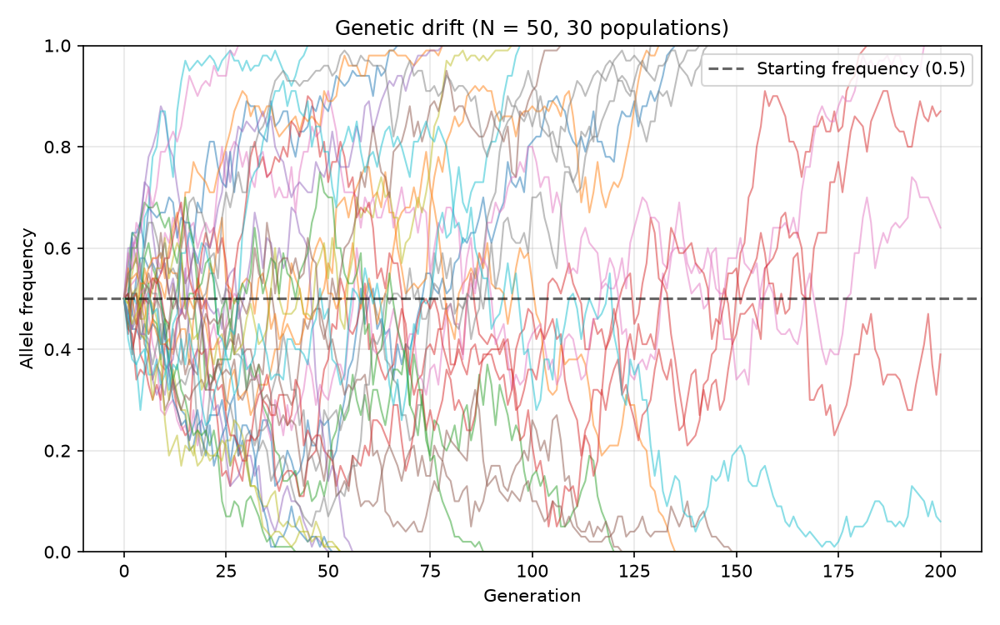
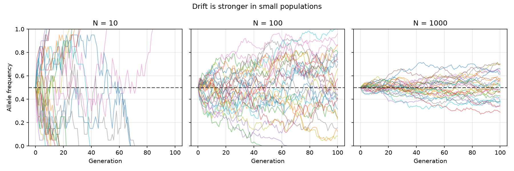
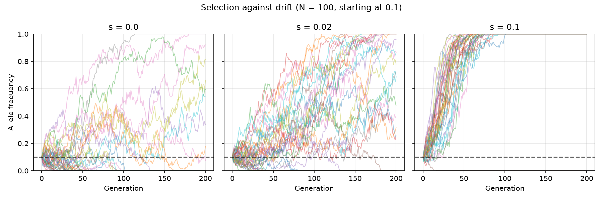

# Genetic Simulatior model of genetic drift

A stochastic simulation of allele frequency change in finite populations,
used to reproduce three classical results in population genetics.

**Main finding:** a beneficial mutation is usually lost. A new mutation
conferring a 1% fitness advantage fixed in only 1.8% of 5,000 simulated
populations — close to Haldane's analytic prediction of 2s = 2%. Selection
cannot act on an allele that drift eliminates while it is still rare.

## The model

A population of N diploid individuals carries 2N copies of a gene, of
which a fraction p are allele A. Each generation the population is
entirely replaced, and every copy in the new generation is drawn at
random with replacement from the previous gene pool:

That is the entire model. No individual is fitter than any other in the
neutral case — frequency changes arise purely from sampling error.

This wandering is **genetic drift**. It is the null model of population
genetics: the change you expect with no selection at all, and therefore
the thing that must be ruled out before any observed frequency change is
attributed to selection.

Because p = 0 and p = 1 are absorbing states — once every copy is the
same allele there is nothing left to sample — drift eventually eliminates
all variation in a finite population.

### Selection

With a selection coefficient s favouring A, selection shifts the expected
frequency before sampling occurs:

Selection sets the expectation; drift supplies the noise around it.

## Results

### 1. Fixation probability equals starting frequency

Starting from p₀ = 0.3, 1,000 populations of N = 50 were run for 1,000
generations, by which point all had resolved.

| Outcome | Count |
|---|---|
| Fixed | 289 |
| Lost | 711 |
| Still segregating | 0 |

Theory predicts a neutral allele fixes with probability equal to its
starting frequency, so 300 of 1,000 were expected. The observed 289 is
within sampling noise.

The reason is simple once seen: every gene copy present today is equally
likely to be the ancestor of the entire future population, so the chance
that the eventual winner is an A copy is just the fraction of copies that
are A.

This result also serves as a validation of the implementation — code that
failed to recover p₀ would be wrong somewhere.



Thirty genetically identical populations diverge entirely by chance. Lines
reaching 0 or 1 stop moving: fixation is irreversible.

### 2. Drift is stronger in small populations



Identical starting frequency and number of generations; only N differs.
At N = 10 almost every population resolves within 60 generations. At
N = 1,000 the frequencies have barely moved after 100.

The standard deviation of a binomial proportion is √(p(1−p)/2N), so
per-generation jitter falls as population size rises. Quadrupling N halves
the step size.

This is the basis of the concern about population bottlenecks in
conservation genetics: a population reduced to a few dozen individuals
loses genetic variation rapidly and permanently, with no selection
involved, and recovering in numbers does not restore what was lost.

### 3. Most beneficial mutations are lost

A single new mutant copy (p₀ = 1/2N) with s = 0.01 was introduced into
5,000 independent populations of N = 1,000 and followed for 2,000
generations.

| | Fixation probability |
|---|---|
| Observed | 0.0180 |
| Haldane's prediction (2s) | 0.0200 |

98% of beneficial mutations were lost. Not because they were outcompeted,
but because a single copy is easily lost to sampling noise before
selection has enough frequency to act on.

The small shortfall against 2s is expected: Haldane's result is an
approximation valid for small s and large N, and slightly overestimates.
With 5,000 replicates the standard error is roughly 0.0019, placing the
observed value about one standard error below the prediction.



Note that this figure starts at p₀ = 0.1 — twenty copies — rather than a
single copy, which would be invisible on this axis. It therefore
understates how often loss occurs, and should not be read as contradicting
the 2s result above. What it does show is that stronger selection produces
not just faster fixation but more repeatable outcomes: under neutrality
every population takes its own path, while under strong selection the
trajectories converge.

## Limitations

**Non-overlapping generations.** The entire population is replaced each
generation, which suits annual plants or laboratory microbes but not
species with overlapping cohorts.

**Constant population size.** Real populations fluctuate, and drift is
dominated by the smallest sizes a population passes through. The effective
population size relevant to drift is closer to the harmonic mean of
census sizes than the arithmetic mean.

**One locus, two alleles, no linkage.** Real genomes have many loci in
linkage disequilibrium, where selection at one site drags neighbouring
variation along. This model cannot show genetic hitchhiking or background
selection.

**No mutation.** Variation is only ever destroyed here, never created, so
every population eventually becomes monomorphic. Adding recurrent mutation
would produce a mutation-drift equilibrium instead.

**Random mating and no structure.** Geographic subdivision, assortative
mating and migration all alter how drift proceeds.

## Running it

```bash
git clone <your-repo-url>
cd wright-fisher

python -m venv venv
venv\Scripts\activate        # Windows
source venv/bin/activate     # macOS / Linux

pip install -r requirements.txt

python drift.py     # the selection experiment (takes a few minutes)
python plots.py     # generate all figures
```

Random seeds are fixed, so all results above are reproducible.

## Files
